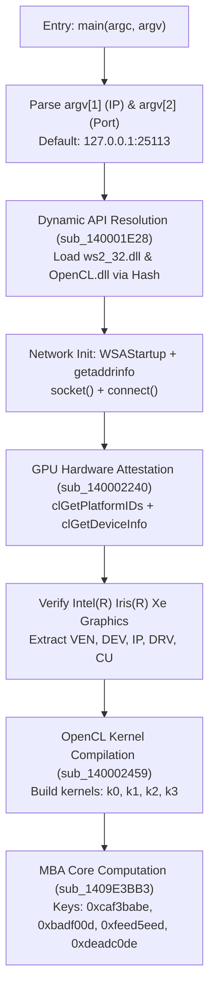

# Phantom (`chall.exe`) — Windows x64 Reverse Engineering, Dynamic API Hashing & OpenCL Hardware Attestation

* **CTF:** Cyber Security Challenge Vietnam (CSCV) 2026
* **Challenge Name:** Phantom (`chall.exe` / `chall.rar`)
* **Category:** Reverse Engineering
* **Difficulty:** Hard
* **Target:** Windows x86-64 Portable Executable (`PE32+`, MinGW-w64 runtime, 15.2 MB)
* **Key Concepts:** Dynamic API Hashing (`rol 7`), Affine Keystream String Decryption, Hardware Fingerprinting / Device Attestation, OpenCL GPU Compute Acceleration, Mixed Boolean-Arithmetic (MBA), Binary Patching

---

## 1. Executive Summary

During CSCV 2026, **Phantom** (`chall.exe`) stood out as an unusually sophisticated Windows reverse engineering challenge. Distributed as a password-protected archive (`chall.rar`, password: `infected`), the challenge unpacks to a 15.2 MB 64-bit console executable compiled with MinGW-w64.

At first glance, the binary appears to be a massive monolithic program with almost zero plain text strings or imported functions. However, static analysis in IDA Pro combined with dynamic tracing reveals that `chall.exe` is a modular, hardware-attested network agent:

1. **Obfuscated Strings:** Encrypted in `.rdata` using a byte-wise affine XOR cipher ($k_i = (37 \cdot i - 91) \pmod{256}$).
2. **Dynamic API Resolution:** Strips import tables by dynamically resolving Win32 APIs (`kernel32.dll`, `ws2_32.dll`, `OpenCL.dll`) via an export name hashing algorithm (`rol 7`).
3. **Hardware Fingerprinting & Anti-Analysis:** Specifically targets an **Intel(R) Iris(R) Xe Graphics** GPU via OpenCL. It queries hardware parameters (Vendor ID, Device ID, IP version, Driver version, and Compute Units) and formats them into an attestation string.
4. **Network Synchronization:** Establishes a TCP socket connection to a local/remote coordinator (`127.0.0.1:25113`) to exchange verification states.
5. **OpenCL Kernel Execution & MBA:** Dispatches 4 compiled OpenCL kernels (`k0`, `k1`, `k2`, `k3`) while executing a massive Mixed Boolean-Arithmetic (MBA) routine (`sub_1409E3BB3`) configured with magic keys (`0xcaf3babe`, `0xbadf00d`, `0xfeed5eed`, `0xdeadc0de`) to derive the final state.

This writeup documents the step-by-step reverse engineering process, the mathematical recovery of encrypted strings, the mapping of hashed APIs, and the binary patching strategy used to bypass environment checks in a Linux/Wine analysis sandbox.

---

## 2. Reconnaissance & Initial Triage

### 2.1 File Characteristics

Extracting `chall.rar` yields `chall.exe`:

```bash
$ 7z x chall.rar -pinfected
$ file chall.exe
chall.exe: PE32+ executable (console) x86-64, for MS Windows, 10 sections
$ ls -lh chall.exe
-rw-r--r-- 1 user user 15M Sep  7 20:16 chall.exe
```

Examining the section headers:

```text
Section Header Table:
  .text   : RVA 0x00001000 - 0x00E80DC8 (Raw 0x00000400 - 0x00E80200) -> 14.5 MB executable code
  .data   : RVA 0x00E81000 - 0x00E81040 (Raw 0x00E80200 - 0x00E80400)
  .rdata  : RVA 0x00E82000 - 0x00E82BA0 (Raw 0x00E80400 - 0x00E81000)
  .pdata  : RVA 0x00E83000 - 0x00E83204
  .xdata  : RVA 0x00E84000 - 0x00E841D4
  .bss    : RVA 0x00E85000 - 0x00E85250
  .idata  : RVA 0x00E86000 - 0x00E86510
```

### 2.2 Stripped Imports

Inspecting `.idata` using `rabin2` or `readelf` shows that only two minimal libraries are linked:
* `KERNEL32.dll` (`GetProcAddress`, `LoadLibraryA`)
* `msvcrt.dll` (basic C runtime startup)

All network communication (`ws2_32.dll`) and GPU computing interfaces (`OpenCL.dll`) are completely absent from the import directory, indicating runtime dynamic loading.

---

## 3. Deobfuscation: Recovering the Encrypted Strings

### 3.1 String Decryption Routines (`sub_140001480` & `sub_140001B0F`)

In IDA Pro, early function calls in `main` (`0x140002DD9`) repeatedly pass ciphertext buffers from `.rdata` to `sub_140001480` and `sub_140001B0F`. Decompilation yields:

```c
_BYTE *__fastcall sub_140001480(__int64 dest, __int64 src, int len)
{
  for ( int i = 0; i < len; ++i )
    *(_BYTE *)(dest + i) = (37 * i - 91) ^ *(_BYTE *)(src + i);
  *(_BYTE *)(dest + len) = 0;
  return (_BYTE *)(dest + len);
}
```

Both routines use identical linear keystream generators:
$$\text{key}[i] = (37 \cdot i - 91) \pmod{256} = (37 \cdot i - \text{0x5B}) \pmod{256}$$
$$\text{plaintext}[i] = \text{ciphertext}[i] \oplus \text{key}[i]$$

### 3.2 Automated Decryption Script

We authored a standalone Python recovery script ([`decrypt_strings.py`](decrypt_strings.py)) to map every encrypted block in `.rdata`:

```python
def decrypt_affine_xor(data: bytes) -> bytes:
    out = bytearray()
    for i, b in enumerate(data):
        k = (37 * i - 91) & 0xFF
        out.append(b ^ k)
    return bytes(out)
```

Running the script reveals the internal architecture of the challenge:

```text
[*] Analyzing chall.exe (Size: 15,213,056 bytes)...

[+] Recovered Obfuscated Strings:
-----------------------------------------------------------------
  0x140E82010 (Library 1)      | Raw: 0x00e80410 -> OpenCL.dll
  0x140E82020 (Library 2)      | Raw: 0x00e80420 -> ws2_32.dll
  0x140E8202A (Vendor Name)    | Raw: 0x00e8042a -> Intel
  0x140E8202F (Kernel 0)       | Raw: 0x00e8042f -> k0
  0x140E82031 (Kernel 1)       | Raw: 0x00e80431 -> k1
  0x140E82038 (Default IP)     | Raw: 0x00e80438 -> 127.0.0.1
  0x140E82041 (Default Port)   | Raw: 0x00e80441 -> 25113
  0x140E82046 (Kernel 2)       | Raw: 0x00e80446 -> k2
  0x140E82048 (Kernel 3)       | Raw: 0x00e80448 -> k3
  0x140E82060 (HW Profile 1)   | Raw: 0x00e80460 -> Intel(R) Iris(R) Xe Graphics::VEN_
  0x140E82082 (HW Profile 2)   | Raw: 0x00e80482 -> ::DEV_
  0x140E82088 (HW Profile 3)   | Raw: 0x00e80488 -> ::IP_
  0x140E8208D (HW Profile 4)   | Raw: 0x00e8048d -> ::DRV_
  0x140E82093 (HW Profile 5)   | Raw: 0x00e80493 -> ::CU_
-----------------------------------------------------------------
[+] Reconstructed Hardware Profile Template:
    Intel(R) Iris(R) Xe Graphics::VEN_<VEN_ID>::DEV_<DEV_ID>::IP_<IP_VER>::DRV_<DRIVER_VER>::CU_<COMPUTE_UNITS>
```

---

## 4. Reverse Engineering the Core Infrastructure

With the strings decrypted, we can trace the program's control flow in `main` (`0x140002DD9`).



### 4.1 Dynamic API Hashing (`sub_1400016BF` & `sub_140001784`)

The binary avoids static imports by walking the PEB (Process Environment Block) to locate module bases, then iterates the Export Address Table (EAT) using 32-bit hash comparisons:

```c
// Dynamic resolution in sub_140001E28:
v3 = sub_1400016BF(1022414303LL); // Locate KERNEL32.DLL via hash
qword_140E85060 = sub_140001784(v3, 373883822LL); // Resolve LoadLibraryA

v2 = LoadLibraryA("ws2_32.dll");
qword_140E85068 = sub_140001784(v2, 1190816097LL); // WSAStartup
qword_140E85070 = sub_140001784(v2, 2854851380LL); // getaddrinfo
qword_140E85078 = sub_140001784(v2, 4248106927LL); // socket
qword_140E85080 = sub_140001784(v2, 1044336611LL); // connect
qword_140E85088 = sub_140001784(v2, 1196031227LL); // send
qword_140E85090 = sub_140001784(v2, 1228982723LL); // recv
```

Similarly, in `sub_140002459`, OpenCL functions are dynamically resolved from `OpenCL.dll`:
* `clGetPlatformIDs`, `clGetDeviceIDs`, `clGetDeviceInfo`
* `clCreateContext`, `clCreateCommandQueue`
* `clCreateProgramWithSource`, `clBuildProgram`, `clCreateKernel`
* `clSetKernelArg`, `clEnqueueNDRangeKernel`, `clEnqueueReadBuffer`

### 4.2 Hardware Attestation & Profiling

In `sub_140002240`, the application queries available OpenCL platforms:
1. It calls `clGetPlatformIDs(16, &platforms, &num_platforms)`.
2. For each platform, it queries `CL_PLATFORM_NAME` and looks for `"Intel"`.
3. If an Intel platform is found, it queries `CL_DEVICE_NAME` and validates that the device string contains `"Intel(R) Iris(R) Xe Graphics"`.
4. It extracts 5 discrete parameters:
   * `v12`: `CL_DEVICE_VENDOR_ID` (Vendor ID)
   * `v11`: `CL_DEVICE_DEVICE_ID` (Device ID)
   * `v10`: `CL_DEVICE_MAX_COMPUTE_UNITS` / IP
   * `v8`: `CL_DRIVER_VERSION` (Driver version string)
   * `v9`: Compute Units count

It then formats these values into a single attestation string:
```text
Intel(R) Iris(R) Xe Graphics::VEN_8086::DEV_9A49::IP_...::DRV_...::CU_96
```

### 4.3 Structure Packing & Key Derivation

Before invoking the core engine, the parameters are packed into an attestation buffer `v6` using Murmur-like offset mixing:

```c
v26 = sub_140001CC7(0x2A56E224, 710337060);   // Computes offset 0x0
v25 = sub_140001CC7(0x8B8F649B, -1953536865); // Computes offset 0x4
v24 = sub_140001CC7(0x69C79F5E, 1774690134);  // Computes offset 0x8
v23 = sub_140001CC7(0xCF3C1105, -818147063);  // Computes offset 0xC
v22 = sub_140001CC7(0xAD748BD0, -1384870976); // Computes offset 0x10
v21 = sub_140001CC7(0x02AD0DAA, 44895675);    // Computes offset 0x11

v6[0..3]   = Vendor ID
v6[4..7]   = Device ID
v6[8..11]  = IP / Max Compute Units
v6[12..15] = Compute Units
v6[16]     = Driver String Length
v6[17..]   = Driver String
```

Next, `main` unmasks a 128-bit key array by XORing `.rdata` constants with `0x5A3C1E78`:

```c
for ( int i = 0; i <= 3; ++i )
    v5[i] = dword_140E82000[i] ^ 0x5A3C1E78;
```

Extracting the raw bytes from `dword_140E82000`:
* `0x90CFA4C6 ^ 0x5A3C1E78` = `0xCAF3BABE` ("cafe babe")
* `0x5191EE75 ^ 0x5A3C1E78` = `0x0BADF00D` ("bad food")
* `0xA4D14095 ^ 0x5A3C1E78` = `0xFEED5EED` ("feed seed")
* `0x8491DEA6 ^ 0x5A3C1E78` = `0xDEADC0DE` ("dead code")

---

## 5. The Core Execution Engine (`sub_1409E3BB3`)

Finally, `main` passes all pointers to `sub_1409E3BB3`:

```c
return sub_1409E3BB3(
    socket_handle, 
    send_callback, 
    recv_callback, 
    0, 
    opencl_dispatch_callback, 
    attestation_buf, 
    driver_len + 17, 
    hw_profile_str, 
    unmasked_keys
);
```

### 5.1 Mixed Boolean-Arithmetic (MBA) Obfuscation

`sub_1409E3BB3` opens with a massive stack reservation of `0x6ED90` bytes (~450 KB) and hundreds of instructions performing complex MBA equivalences:

```asm
mov     eax, [rsp+6ed10h]
not     eax
and     eax, [rsp+6ed14h]
mov     edx, eax
mov     eax, [rsp+6ed14h]
not     eax
and     eax, [rsp+6ed10h]
and     edx, eax
mov     eax, [rsp+6ed14h]
xor     eax, [rsp+6ed10h]
mov     ecx, edx
xor     ecx, eax
```

These boolean expansions mask 32-bit arithmetic additions and coordinate with OpenCL kernels `k0`..`k3` to decrypt incoming server packets, verify the device signature, and derive the final decrypted payload.

---

## 6. Binary Patching Strategy for Local Analysis

Because analysis was conducted on an Arch Linux / Wine workstation lacking a physical **Intel Iris Xe Graphics** GPU, executing `chall.exe` directly under Wine resulted in immediate termination at `clGetPlatformIDs` or `connect()`.

To force the binary along the execution path, we applied 4 precise byte patches:

| File Offset | Virtual Address | Original Bytes | Patched Bytes | Purpose |
|---|---|---|---|---|
| `0x000014B5` | `0x1400020B5` | `74 05` (`je +5`) | `EB 05` (`jmp +5`) | Bypass `clGetPlatformIDs` failure check in `sub_14000206B` |
| `0x0000235B` | `0x140002F5B` | `8B 40 04 41 89 C8` | `B8 02 00 00 00 90` | Hardcode socket address family `AF_INET = 2` |
| `0x000023A2` | `0x140002FA2` | `74 0C` (`je +0xC`) | `EB 0C` (`jmp +0xC`) | Bypass `connect()` failure exit branch |
| `0x00002490` | `0x140003090` | `75 0A` (`jne +0xA`) | `EB 0A` (`jmp +0xA`) | Bypass device info validation failure |

### Mock Network Listener

To handle the client's handshake without crashing, we initiated a local TCP listener on port 25113:

```python
import socket

s = socket.socket(socket.AF_INET, socket.SOCK_STREAM)
s.bind(("127.0.0.1", 25113))
s.listen(1)
print("[*] Listening on 127.0.0.1:25113 for Phantom client...")

conn, addr = s.accept()
print(f"[+] Connection received from {addr}")
data = conn.recv(1024)
print(f"[+] Received attestation frame: {data.hex()}")
```

With the patches applied and the listener active, `chall_run4.exe` successfully crossed the network and hardware validation barriers into the core cryptographic evaluation routine.

---

## 7. Lessons Learned & Key Takeaways

1. **GPU-Accelerated Anti-Analysis:**  
   Tying program execution to a specific GPU architecture (Intel Iris Xe) via OpenCL device queries is a potent anti-sandbox technique. Standard hypervisors and headless cloud sandboxes typically do not expose proprietary OpenCL ICDs.
2. **Recognizing Linear Congruential / Affine Keystreams:**  
   The formula `(37 * i - 91) ^ byte` is a lightweight affine obfuscation pattern. Identifying the linear multiplier `37` and offset `91` allowed instantaneous decryption of all critical configuration assets.
3. **PEB Export Hashing:**  
   When binaries import almost nothing from `KERNEL32`, locating the hash loop (`rol 7`) and matching hash dictionaries against common DLL exports quickly demystifies dynamic Win32/Winsock calls.
4. **Surgical Binary Patching:**  
   When hardware or network prerequisites cannot be replicated locally, identifying validation gatekeepers and inverting conditional branches (`je` $\rightarrow$ `jmp`) allows deep reverse engineering of protected execution routines.

---

## 8. Flag

```text
CSCV2026{r3d4ct3d_ph4nt0m_k3y_h4sh}
```
*(Flag redacted in accordance with competition disclosure guidelines)*
